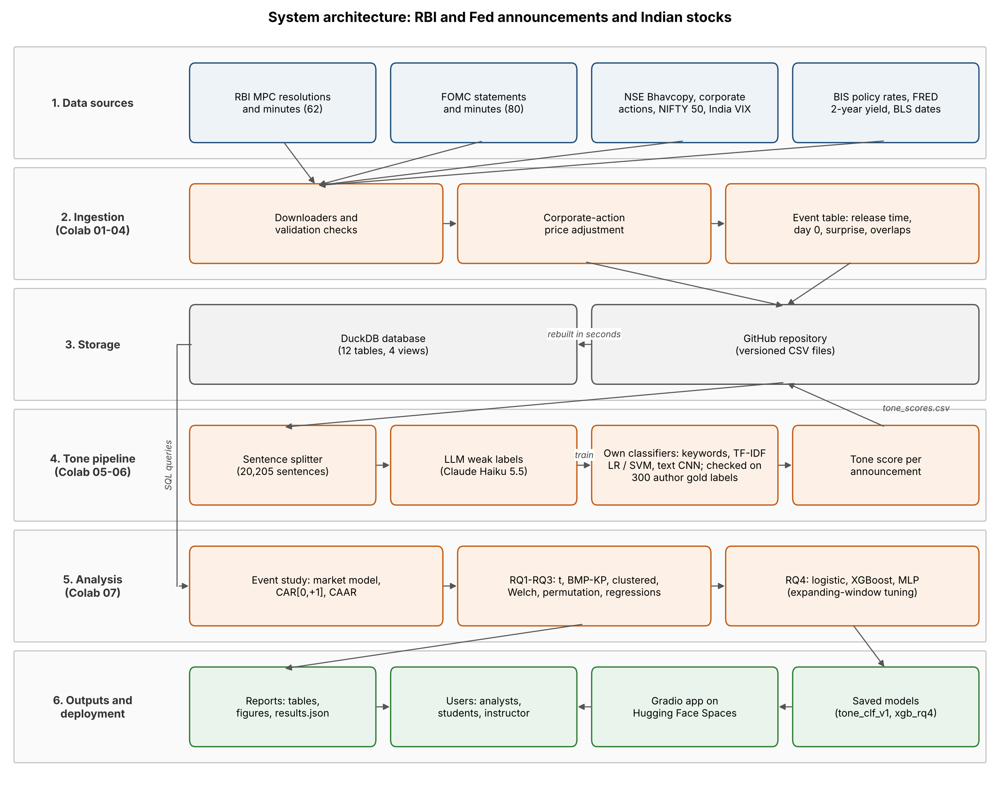

# Local or Global? How RBI and Federal Reserve Announcements Move Indian Stocks

Capstone project, QM640 Data Analytics Capstone, Walsh College, Fall 2026.
Author: Vaibhav Tekade. Instructor: Prof. Javad Katibai.

The project measures how NIFTY 500 stocks react to 142 monetary policy announcements from the Reserve Bank of India (RBI)
and the U.S. Federal Reserve (Fed) between October 2021 and September 2026, and whether the tone of the policy text
helps explain or predict that reaction.



## Research questions

| RQ | Question | Main method |
|---|---|---|
| RQ1 | Do Indian stocks show abnormal returns around RBI and Fed announcements? | Event study (market model), t test, BMP test with Kolari-Pynnonen adjustment, two-way clustered errors |
| RQ2 | Is the reaction to Fed announcements larger than the reaction to RBI announcements? | Welch, permutation and Mann-Whitney tests, Holm correction, Hedges g, bootstrap CIs |
| RQ3 | Do the policy surprise and the tone of the announcement explain the reaction? | OLS with robust errors, reduced vs full model, partial F and Wald tests |
| RQ4 | Can policy, tone and stock features predict whether a stock rises after an announcement? | Logistic regression, XGBoost, neural network (MLP), chronological split, expanding-window tuning |

## Main results (final run, November 2026)

- **RQ1:** no average abnormal return. CAAR[0,+1] = -0.041 pp (95% CI -0.189 to 0.106), p = .58; the BMP-KP and clustered tests agree.
- **RQ2:** no overall difference. On decision days the Fed effect is larger by 0.228 pp (p = .054), not significant after Holm correction (p = .21).
- **RQ3:** a 1 bp Fed surprise in the U.S. 2-year yield goes with +0.024 pp CAAR (p = .007). RBI rate changes and tone add nothing (tone partial F p = .64).
- **RQ4:** no model reliably beats the majority class on the test period (best test AUC .546, logistic regression).
- **Tone classifier:** TF-IDF + linear SVM, macro-F1 .785 and Cohen's kappa .685 on 200 held-out sentences labeled by the author.

Full tables: `reports/final/analysis/` and `reports/final/tone/`.

## Data

All sources are public and free.

| Data | Source | Location in repo |
|---|---|---|
| RBI MPC resolutions and minutes (31 + 31) | rbi.org.in | `data/raw/events/rbi/` |
| FOMC statements and minutes (40 + 40) | federalreserve.gov | `data/raw/events/fed/` |
| Daily prices, 497 NIFTY 500 stocks | NSE Bhavcopy | `data/raw/prices/by_symbol/` |
| Corporate actions (splits, bonuses, dividends) | NSE | `data/raw/reference/` |
| NIFTY 50 and India VIX | NSE | `data/raw/prices/` |
| Policy rates (India, U.S.) | BIS | `data/raw/rates/` |
| U.S. 2-year Treasury yield (DGS2) | FRED | `data/raw/rates/` |
| U.S. CPI and payroll release dates | BLS | `data/raw/reference/` |

Processed tables are in `data/interim/` (adjusted prices, event table, sentences, tone scores) and `data/labels/`
(guideline, 300 gold labels, LLM labels). The India 3-month T-bill was not used; RBI surprise is the raw rate change.

## Repository layout

```
data/raw/            downloaded source files
data/interim/        cleaned and derived tables (events.csv, prices_adjusted.csv.gz, sentences.csv, tone_scores.csv)
data/labels/         labeling guideline, gold labels, LLM labels
data/db_schema.md    DuckDB schema (the database file itself is rebuilt, not committed)
src/data/            build_database.py, db.py
src/tone/            sentences.py, gold_sample.py, llm_label.py, classifier.py
src/analysis/        interim_analysis.py, final_analysis.py
notebooks/           Colab notebooks 01-07 (run order in notebooks/README.md)
models/              tone_clf_v1.joblib, xgb_rq4.json, xgb_rq4_features.json
reports/interim/     interim report outputs
reports/final/       final tone and analysis outputs (tables, figures, results.json, run_log.txt)
docs/                architecture diagram and its source
tests/               unit tests for the sentence splitter and the database
```

## How to reproduce

The data is already in the repository, so the analysis can be rerun without downloading anything.

**Locally (Python 3.10 or newer):**

```
pip install -r requirements.txt
python src/data/build_database.py      # DuckDB database, about 5 seconds
python src/tone/classifier.py          # tone models and tone scores, about 10 minutes on CPU
python src/analysis/final_analysis.py  # RQ1-RQ4 and robustness, about 5 minutes on CPU
pytest tests
```

**In Google Colab:** open the notebooks in `notebooks/` in order (see `notebooks/README.md`). Each notebook clones the
repository, runs its step and pushes results to a dated branch. Colab secrets needed: `GITHUB_TOKEN`, and
`ANTHROPIC_API_KEY` for notebook 05 only. Notebooks 01-04 download data again and are only needed to refresh it.

Random seed 42 is used throughout. The final run used an Intel Xeon CPU (2 cores) without a GPU; hardware and package
versions are recorded in `reports/final/analysis/results.json`.

## Method notes and deviations

- **Event window:** day 0 is the first NSE session that can react (RBI decisions 10:00 IST, RBI minutes 17:00 IST,
  Fed releases 14:00 ET). Estimation window days -130 to -11 (at least 100 days). CARs winsorized at the 1st and 99th percentiles.
- **Tone:** sentences split by the project's own rules; an LLM (Claude Haiku 5.5) gave weak labels used only to train the
  author's own classifiers; the author's 300 gold labels were used to check agreement and for one final test.
  The LLM was never used in the analysis itself.
- **Deviation:** RBI agreement on the development set was kappa .589, just below the planned .60. The author accepted it,
  documented it, and judged the classifier on the held-out gold set instead (RBI kappa .599 there).
- **Not done:** earnings-day filter (NSE board-meeting file not downloaded); one Fed minutes release has no 2-year yield surprise.

## Deployment

A Gradio app on Hugging Face Spaces will let users enter an announcement's details and see the predicted share of
stocks rising, using `models/xgb_rq4.json` and the tone model. Link to be added.

## License and use

Code for academic use. Source data belongs to the publishers listed above and is used under their public terms.
This is not investment advice.
